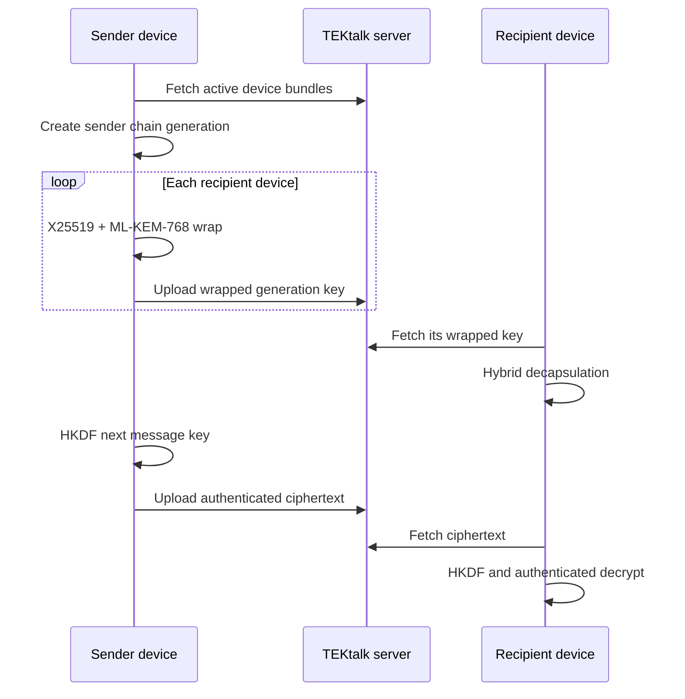
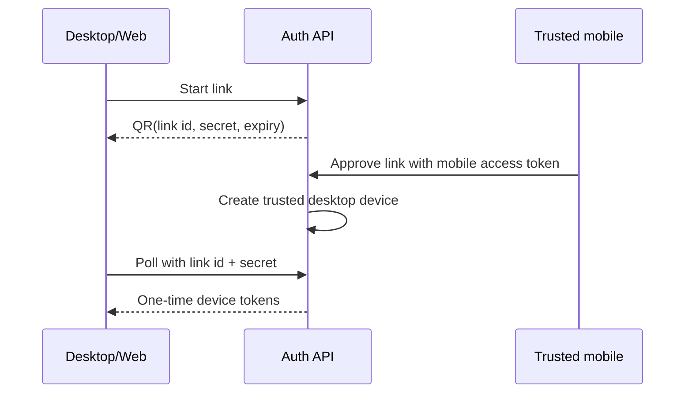

# TEKtalk Secret Level 3 architecture

Status: implemented baseline for opt-in 1:1 and group conversations. The normal MTProto 2.0 transport remains available; Secret mode changes content protection and device trust, not the outer transport.

## Security target

Level 3 means every enabled device participates independently, messages use a one-time symmetric message key, and fresh hybrid post-quantum material periodically heals a compromised sender chain. The server stores device public bundles, per-device wrapped sender keys, and ciphertext. It never receives plaintext sender keys.

The mandatory suite is `TEKTALK_LEVEL3_X25519_MLKEM768_AES256GCMSIV_SHA256`. A client rejects missing or weaker suites instead of silently falling back.

| Property | Mechanism |
|---|---|
| Multi-device trust | A mobile session explicitly approves a short-lived QR link for each Web, macOS, or Windows device |
| Per-device secrecy | A sender key is wrapped separately to every recipient device with a fresh X25519 + ML-KEM-768 hybrid exchange |
| Per-message secrecy | HKDF advances the sender chain and derives a new AES-256-GCM-SIV key for each counter |
| Out-of-order delivery | Receivers retain at most 2,000 skipped message keys and reject replayed counters |
| Post-compromise recovery | A new hybrid generation is distributed every 50 sent messages and whenever membership changes |
| Group changes | Epoch increments invalidate old membership; removed devices receive no keys for the new epoch |
| Local protection | Core snapshots contain secrets and must be stored using Keychain/Keystore/DPAPI-backed encrypted storage |

## Message and key flow

Associated data binds the conversation, epoch, generation, sender device, counter, and suite. A changed field causes authenticated decryption to fail. Each generation has its own counter space and database uniqueness constraint.

## Desktop QR login

Web, macOS, and Windows request a random 256-bit link secret. The server stores only an HMAC digest and returns a QR URI valid for three minutes. Android or iOS opens the URI under an already authenticated session and approves it. The desktop must prove possession of the secret while polling; the result can be claimed once. Access and refresh tokens are minted only at claim time and are never stored in the QR challenge row.

QR approval establishes account-device authorization. Secret Chat then generates a device crypto identity and publishes its bundle. Users must be able to revoke the desktop device; a revocation forces a new group epoch.

## Trust boundary and remaining hardening

This release implements the Level 3 ratchet and pairwise per-device distribution. It does not claim protection from a fully malicious TEKtalk directory server substituting an entirely new device bundle. Closing that gap requires an account identity signature, auditable key transparency proofs, safety-number UI, and cross-signing new device keys during QR approval. Those are the next protocol version and must not be represented in the UI as already delivered.

Operational requirements are: TLS for every API, rate limits on link creation/polling, deletion of expired challenges, encrypted client snapshots, device-revocation notifications, and independent cryptographic review before production rollout.

## Compatibility

Messages and wrapped packets now include `generation` (default `1` for migration). Receiver snapshots accept the prior tuple format and restore it as generation 1. Database migration `004_device_link.sql` adds generation-aware primary/unique keys and the one-time device-link table.
